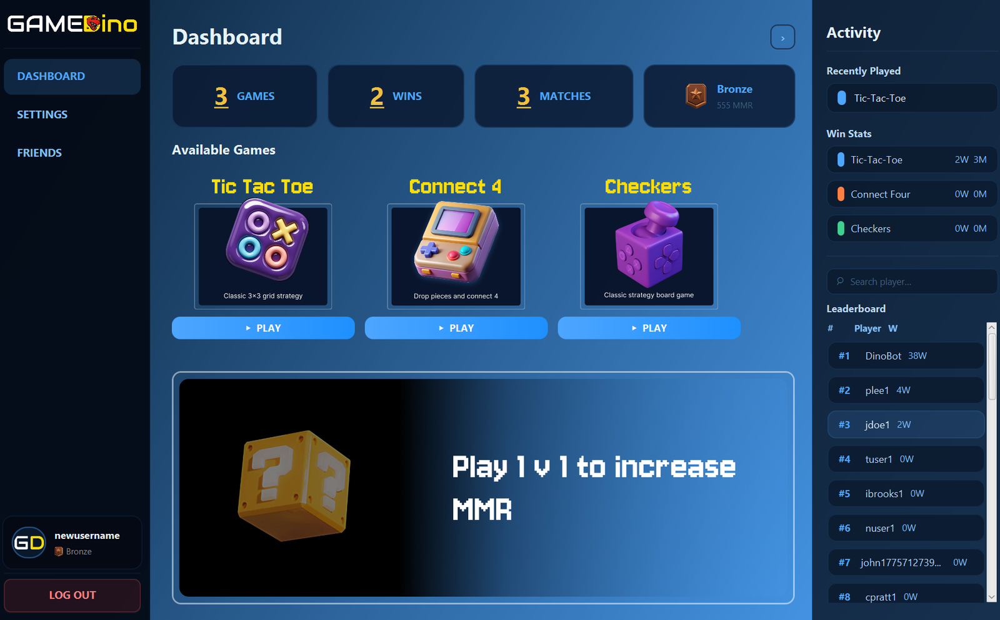
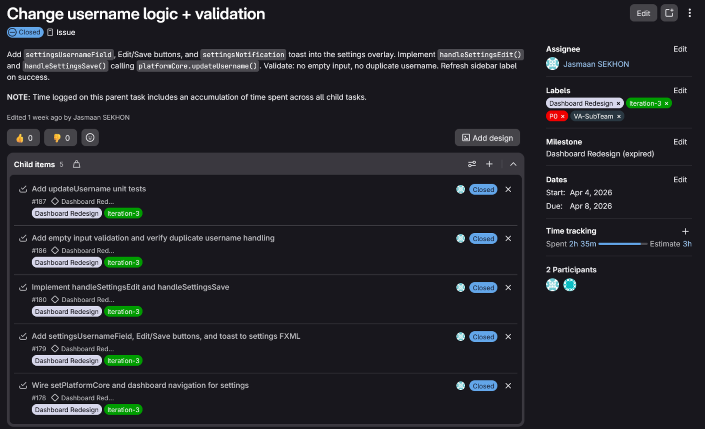

# GameDino

A multiplayer board game platform built in Java and JavaFX. The project is focused on the platform around the games. This includes accounts and profiles, matchmaking with ranks, game rooms, and a client-server setup that lets players compete over the network or locally against a bot.

Built by a 16 person team over three iterations in a university software engineering course. It was developed on GitLab, and this repo is a snapshot of the final version.



## Platform features

- Client-server networking over WebSockets and HTTP with a local mode when no server is running
- Matchmaking queue with MMR based ranks and a leaderboard
- Game rooms and lobbies, friends, and match history
- An event bus connecting the platform's components
- A pluggable game engine, so each game only implements its own rules
- JSON persistence for accounts, profiles, and stats

## How we worked

- The team was split into three subteams: Platform Core, Rules & Validation, and Client/UI
- Features were tracked as GitLab work items, broken into smaller tasks, each with a time estimate and logged time
- Each feature was built on its own branch and merged through a reviewed merge request
- The design was documented with state, class, use case, and sequence diagrams (see `docs/`)

One of my work items, broken into child tasks with labels, a milestone, and time tracking:



## My contributions

I was on the Rules & Validation subteam. Near the end of the project, I also helped the Platform Core and Client/UI subteams.

- TicTacToe: implemented the game logic (move validation, turn tracking, win and draw detection, winner selection) and its unit tests
- Checkers: implemented end of game detection and winner selection (piece counting, legal move checks) with unit tests
- Change username: built the settings UI for editing a username, connected it to the platform core with input validation, and added 7 unit tests
- Testing: added platform core tests for password verification, password updates, and the friend request system
- Design: refined the validation class diagram and platform state diagram

## Build and run

Requires JDK 25. Maven is included through the wrapper (use `mvnw.cmd` on Windows).

```bash
./mvnw javafx:run
```
