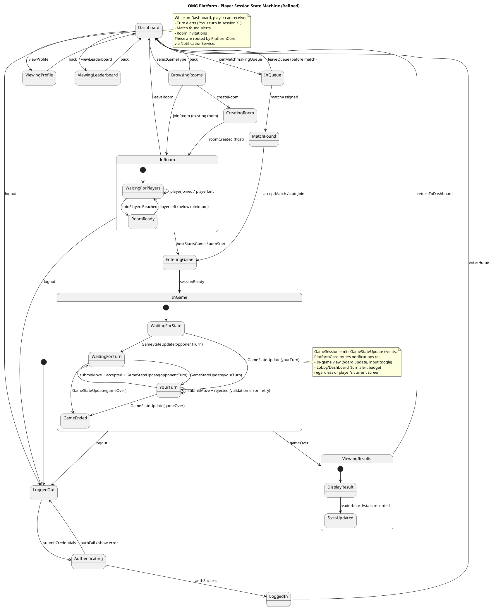

# Platform State Machine (Refined for Iteration 1)

## About

This is the refined Platform Session State Machine for the Platform Core sub-team. It expands the starter diagram with explicit room/lobby states, error recovery paths, and clearer notification routing.

**Refinements from starter:**
- Added explicit Room lifecycle states (CreatingRoom, InRoom, RoomReady)
- Added notification handling for turn alerts while in lobby
- Added reconnection stub path
- Clarified transitions between queue, room, and in-game states

## Owner: Platform Core Sub-team

## PlantUML Editor Code

