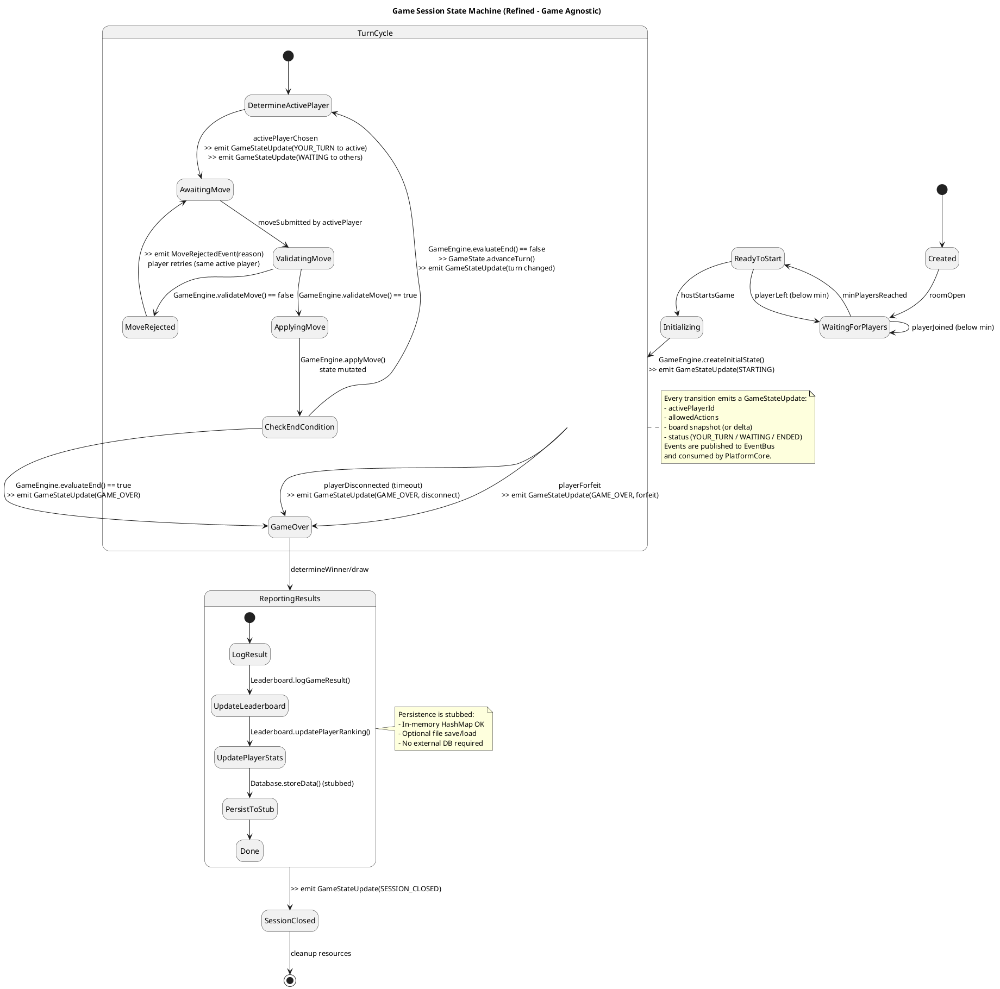

# Game Session State Machine (Refined for Iteration 1)

## About

This is the refined Game Session State Machine. It adds detail around error handling during moves, explicit event emissions at each transition, and clearer end-of-game result reporting flow.

**Refinements from starter:**
- Added explicit error state for invalid moves with retry loop
- Added forfeit/disconnect handling
- Added detailed event emissions at each state transition
- Clarified the result reporting and stats update flow

## Owner: Platform Core Sub-team

## PlantUML Editor Code

