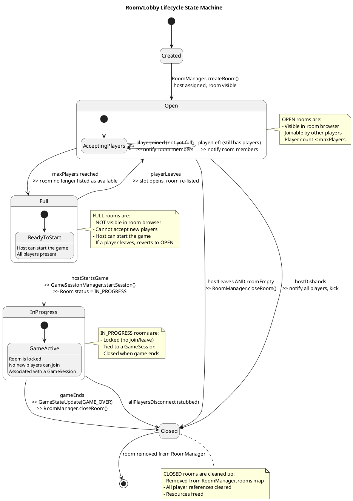

# Room/Lobby Lifecycle State Machine (New for Iteration 1)

## About

This is a new state machine diagram describing the lifecycle of a Room/Lobby in the platform. Rooms are the waiting areas where players gather before a game session begins. This diagram was created by the Platform Core sub-team to formalize room management behavior.

## Owner: Platform Core Sub-team

## PlantUML Editor Code

