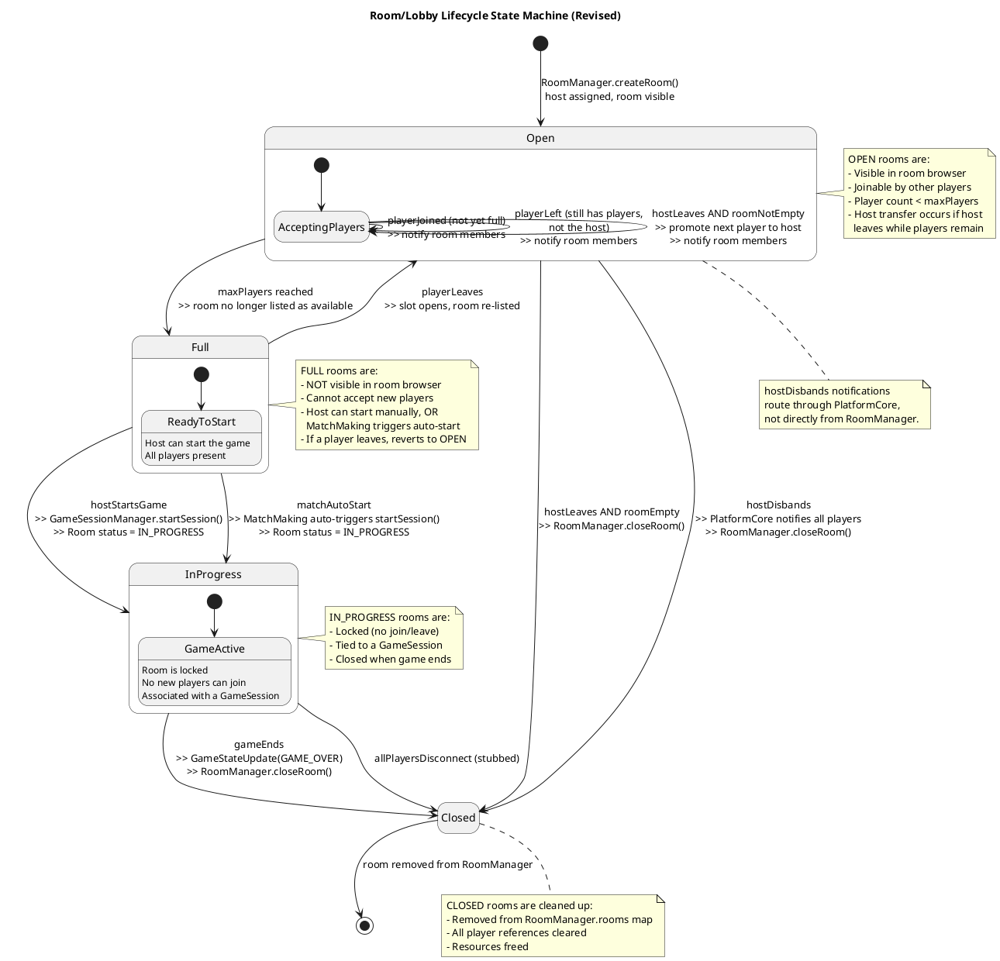

# Room/Lobby Lifecycle State Machine (Revised)

## About

Revised version of the Room/Lobby lifecycle state machine with the following changes from the original:

1. **Removed `Created` transient state** — `Created` has no corresponding `RoomStatus` enum value. The room enters `OPEN` directly on creation.
2. **Added host transfer transition** — when the host leaves but the room still has players, the next player is promoted to host and the room stays `OPEN`.
3. **Added matchmaking auto-start path** — rooms created by `MatchMaking` start automatically without a host click. Added `matchAutoStart` as an alternative transition from `Full → InProgress`.
4. **Clarified host disband routing** — noted that disband/kick notifications route through `PlatformCore`.

## Owner: Platform Core Sub-team

## PlantUML Editor Code

