# Platform Core — High-Level Architecture Diagram (E1.1)

## About

This is the high-level architecture diagram for the Platform Core sub-team. It shows all components, their ownership boundaries (which team member is responsible for each component), and the data flow directions between them.

This diagram is intentionally **not** a class diagram — it omits fields and method signatures in favour of clearly communicating component roles and how data moves through the system. See `02.01 - Platform Core and Services (Refined).md` for the detailed class-level view.

**Last Updated:** 2026-04-10 (reflects Iteration 2 / Integration/phase2-networking implementation)

## Owner: Platform Core Sub-team

## Key Architecture Rules

1. **UI never calls game components directly** — all UI interactions go through `PlatformCore`
2. **Game engines only return state** — they never call `PlatformCore`, `EventBus`, or `NotificationService`
3. **PlatformCore is the sole event consumer** — it subscribes to all 5 event types and decides routing
4. **NotificationService is only called by PlatformCore** — never by publishers or UI directly
5. **Persistence is file-backed** — `UserRepository` and `CredentialsRepository` serialize to JSON on disk; `Database` provides the in-memory cache seeded at startup
6. **Networking is real** — a WebSocket server (`GameWebSocketServer`) and HTTP server (`HttpApiServer`) run in `server/`; clients connect via `NetworkClient` in `client/`

## Ownership Boundaries

| Component(s) | Owner |
|---|---|
| `PlatformCore`, `PlayerContext`, `PlayerProfile`, `GameStatus`, `PlatformError` | Platform Core Sub-team |
| `EventBus`, `EventHandler`, `GameEvent`, `GameStateUpdate`, `MoveRejectedEvent`, `MatchFoundEvent`, `RoomJoinedEvent`, `ChatMessageEvent`, `NotificationService` | Platform Core Sub-team |
| `RoomManager`, `Room`, `RoomStatus` | Platform Core Sub-team |
| `GameSessionManager`, `GameSession`, `GameState`, `GameEngine` (interface), `MoveSubmissionResult` | Platform Core Sub-team |
| `MatchMaking`, `PlayerQueue`, `PartySystem`, `Party` | Platform Core Sub-team |
| `Leaderboard`, `GameResult`, `PlayerRanking`, `Database`, `UserRepository`, `CredentialsRepository`, `PlayerProfileDTO`, `PresenceService` | Platform Core Sub-team |
| `Checkers`, `TicTacToe`, `ConnectFour` (+ Move classes), `Board`, `BoardGame`, `BoardSerializer`, `Piece` | Rules/Validation Sub-team (integrated into `games/`) |
| `Validation`, `ValidationError`, `ChatValidator` | Rules/Validation Sub-team (`validation/`) |
| `DinoBot` | Platform Core (`gameai/`) |
| `GameWebSocketServer`, `HttpApiServer`, `MessageRouter`, `ServerApp`, `SessionRegistry`, `AuthService`, `NotificationAdapter`, DTOs | Platform Core (`server/`) |
| `NetworkClient`, `ServerConnection`, `ClientEventDispatcher` | Platform Core (`client/`) |

## PlantUML Editor Code

```plantuml
@startuml
title Platform Core — High-Level Architecture Diagram (Iteration 2 — Networking)

skinparam packageStyle rectangle
skinparam ArrowColor #333333
skinparam ArrowFontSize 11
skinparam componentStyle rectangle
skinparam defaultTextAlignment center
skinparam linetype ortho

' ============================================================
' EXTERNAL ACTORS
' ============================================================

actor "Player" as Player

package "UI Sub-team\n(External)" <<boundary>> #LightYellow {
    [GUI / Frontend\n(JavaFX Controllers)] as GUI
}

' ============================================================
' PLATFORM CORE BOUNDARY
' ============================================================

package "Platform Core Sub-team" <<boundary>> #LightBlue {

    ' ── Core Orchestration ──────────────────────────────────────
    package "Core Orchestration" <<rectangle>> #PaleTurquoise {
        [PlatformCore] as PC
        [PlayerProfile] as PP
        [PlayerContext] as PCtx
    }

    ' ── Event System ──────────────────────────────────────────
    package "Event System" <<rectangle>> #LightGreen {
        [EventBus] as EB
        [NotificationService] as NS
        [GameStateUpdate\nMoveRejectedEvent\nMatchFoundEvent\nRoomJoinedEvent\nChatMessageEvent] as Events
    }

    ' ── Room / Lobby ──────────────────────────────────────────
    package "Room / Lobby" <<rectangle>> #Wheat {
        [RoomManager] as RM
        [Room] as Room
    }

    ' ── Game Session ──────────────────────────────────────────
    package "Game Session" <<rectangle>> #LightSalmon {
        [GameSessionManager] as GSM
        [GameSession\nGameState] as GS
        [GameEngine\n(interface)] as GameEngineIface
        [MoveSubmissionResult] as MSR
    }

    ' ── Matchmaking ───────────────────────────────────────────
    package "Matchmaking" <<rectangle>> #Lavender {
        [MatchMaking] as MM
        [PlayerQueue\nPartySystem\nParty] as Queue
    }

    ' ── Persistence ────────────────────────────────────────
    package "Persistence" <<rectangle>> #LightGray {
        [Leaderboard\nGameResult\nPlayerRanking] as LB
        [Database] as DB
        [UserRepository\nCredentialsRepository\nPresenceService] as Repos
    }

    ' ── Games (Rules/Validation) ─────────────────────────────
    package "Game Implementations\n[Rules/Validation Sub-team]" <<rectangle>> #MistyRose {
        [Checkers\nTicTacToe\nConnectFour] as Games
        [Board\nBoardSerializer\nPiece] as BoardUtil
    }

    ' ── Validation ───────────────────────────────────────────
    package "Validation\n[Rules/Validation Sub-team]" <<rectangle>> #Thistle {
        [Validation\nValidationError\nChatValidator] as Val
    }

    ' ── AI ───────────────────────────────────────────────────
    package "Game AI\n[Platform Core]" <<rectangle>> #LightCyan {
        [DinoBot] as Bot
    }

    ' ── Networking — Server ──────────────────────────────────
    package "Server\n[Platform Core]" <<rectangle>> #PeachPuff {
        [GameWebSocketServer\nHttpApiServer\nServerApp] as WSServer
        [MessageRouter\nSessionRegistry\nAuthService\nNotificationAdapter] as ServerServices
    }

    ' ── Networking — Client ──────────────────────────────────
    package "Client\n[Platform Core]" <<rectangle>> #Honeydew {
        [NetworkClient\nServerConnection\nClientEventDispatcher] as NetClient
    }
}

' ============================================================
' DATA FLOWS
' ============================================================

' Player → GUI
Player --> GUI : interacts

' UI → PlatformCore (all UI calls route here)
GUI --> PC : login() / logout() / registerPlayer()\nsubmitMove() / sendChatMessage()\njoinQueue() / leaveQueue()\nreturnToDashboard()

' PlatformCore → sub-services (delegation)
PC --> RM      : createRoom() / joinRoom() / leaveRoom()
PC --> MM      : addPlayerToQueue() / removePlayer()
PC --> GSM     : startSession() / submitMove() / endSession()
PC --> NS      : notifyPlayer() / createTurnAlert()\ncreateGameOverAlert() / createMatchFoundAlert()
PC --> DB      : storeData() / retrieveData()
PC --> Repos   : save() / load() / goOnline() / goOffline()

' PlatformCore ← EventBus (event delivery)
EB --> PC      : deliver(GameEvent)\n[5 event types]

' Publishers → EventBus
GSM --> EB     : publish(GameStateUpdate)\npublish(MoveRejectedEvent)
MM  --> EB     : publish(MatchFoundEvent)
PC  --> EB     : publish(RoomJoinedEvent)\npublish(ChatMessageEvent)

' Event types
Events ..> EB  : carried by EventBus

' GameSessionManager → GameEngine (move pipeline)
GSM --> GameEngineIface : createInitialState()\nvalidateMove() → Validation\napplyMove()\nevaluateEnd()\ngetWinner()

' Game implementations implement GameEngine
Games ..|> GameEngineIface : implements

' Move result wrapper
GSM ..> MSR : returns

' Session internals
GSM --> GS     : manages

' Room internals
RM  --> Room   : manages

' Matchmaking internals
MM  --> Queue  : uses

' Game end → leaderboard
GSM --> LB     : logGameResult() / updatePlayerRanking()

' Persistence
LB  --> DB     : storeData() / retrieveData()
DB  <.. Repos  : seeded from / flushed to disk

' AI as a game opponent
Bot ..|> GameEngineIface : implements

' Notifications → UI
NS  --> GUI    : turn alerts / game-over alerts\nmatch-found alerts / inline errors

' Networking — server-side flow
WSServer --> ServerServices : route inbound messages
ServerServices --> PC : delegate platform calls
NS --> ServerServices : push GAME_STATE to remote clients

' Networking — client-side flow
NetClient --> WSServer : WebSocket connection
NetClient --> PC : dispatch received events

' Board utilities
Games --> BoardUtil : uses

' Validation consumed by engines and platform
Games --> Val  : validateMove() uses Validation
PC --> Val     : validateCredentials() / ChatValidator

' ============================================================
' NOTES
' ============================================================

note bottom of PC
  PlatformCore is the central hub.
  All UI input enters here.
  All 5 event types consumed here.
  Credentials hashed with SHA-256.
  Matchmaking polled every 5 s.
end note

note right of EB
  EventBus is the only
  cross-component message channel.
  5 event types: GameStateUpdate,
  MoveRejected, MatchFound,
  RoomJoined, ChatMessage.
end note

note bottom of DB
  Database = in-memory HashMap.
  Seeded at startup from
  UserRepository (users.json)
  and CredentialsRepository
  (credentials.json).
end note

note right of WSServer
  Real WebSocket server
  (org.java-websocket 1.5.7).
  HttpApiServer handles REST.
  NotificationAdapter bridges
  NotificationService → WS push.
end note

@enduml
```

## Data Flow Summary

| Flow | From | To | Data |
|------|----|---|------|
| User interaction | Player | GUI | Clicks, form input |
| UI calls | GUI | PlatformCore | login, registerPlayer, submitMove, joinQueue, sendChatMessage, etc. |
| Room delegation | PlatformCore | RoomManager | Room create/join/leave/close |
| Queue delegation | PlatformCore | MatchMaking | Enqueue / dequeue player; periodic 5 s match attempt |
| Session delegation | PlatformCore | GameSessionManager | Start session, submit move, end session |
| Move result | GameSessionManager | PlatformCore | `MoveSubmissionResult` (accepted or rejected) |
| Notification delegation | PlatformCore | NotificationService | Alert routing |
| Event publish (moves) | GameSessionManager | EventBus | `GameStateUpdate`, `MoveRejectedEvent` |
| Event publish (match) | MatchMaking | EventBus | `MatchFoundEvent` |
| Event publish (room/chat) | PlatformCore | EventBus | `RoomJoinedEvent`, `ChatMessageEvent` |
| Event delivery | EventBus | PlatformCore | All 5 `GameEvent` subtypes |
| Move pipeline | GameSessionManager | GameEngine interface | validate → `Validation`, apply, evaluate, getWinner |
| Engine impl | Checkers / TicTacToe / ConnectFour / DinoBot | GameEngine interface | Implements contract |
| Results recording | GameSessionManager | Leaderboard | logGameResult, updatePlayerRanking |
| Persistence (read) | Database | UserRepository / CredentialsRepository | Seeded at startup from JSON |
| Persistence (write) | UserRepository / CredentialsRepository | data/users.json, data/credentials.json | Flushed on every save |
| Notification delivery | NotificationService | GUI | Banners, alerts, overlays |
| Network push | NotificationAdapter | GameWebSocketServer → NetworkClient | `GAME_STATE` message to remote player |
| Credential validation | PlatformCore | Validation / ChatValidator | Registration fields, chat content |
