# Event Hierarchy Diagram (J1.4)

## About

This diagram defines the complete event hierarchy used in the platform. All events extend the abstract `GameEvent` base class and flow through the `EventBus` to be consumed by `PlatformCore`.

**Covers:**
- `GameEvent` abstract base class
- `GameStateUpdate` — emitted by `GameSessionManager` on every turn change or game-over
- `MoveRejectedEvent` — emitted by `GameSessionManager` when a player submits an invalid move
- `MatchFoundEvent` — emitted by `MatchMaking` when players are paired
- `ChatMessageEvent` — emitted by `PlatformCore` when a player sends an in-session chat message
- `RoomJoinedEvent` — emitted by `PlatformCore` when a player joins another player's room

## Owner: Platform Core Sub-team

## PlantUML Editor Code

```plantuml
@startuml
title Event Hierarchy Diagram
skinparam classAttributeIconSize 0

' ============================================================
' BASE CLASS
' ============================================================
abstract class GameEvent {
  - eventId : String
  - timestamp : long
  - eventType : String
  + getEventId() : String
  + getTimestamp() : long
  + getEventType() : String
}

' ============================================================
' CONCRETE EVENTS
' ============================================================
class GameStateUpdate {
  - sessionId : String
  - recipients : List<String>
  - status : GameStatus
  - activePlayerId : String
  - previousPlayerId : String
  - payload : Object
  - moveResult : String
  - gameOver : boolean
  - winnerId : String
  + getSessionId() : String
  + getRecipients() : List<String>
  + getStatus() : GameStatus
  + getActivePlayerId() : String
  + getPreviousPlayerId() : String
  + getPayload() : Object
  + getMoveResult() : String
  + isGameOver() : boolean
  + getWinnerId() : String
}

class MoveRejectedEvent {
  - sessionId : String
  - playerId : String
  - reason : PlatformError
  - message : String
  + getSessionId() : String
  + getPlayerId() : String
  + getReason() : PlatformError
  + getMessage() : String
}

class MatchFoundEvent {
  - players : List<String>
  - gameType : String
  - roomId : String
  + getPlayers() : List<String>
  + getGameType() : String
  + getRoomId() : String
}

class ChatMessageEvent {
  - sessionId : String
  - senderId : String
  - text : String
  + getSessionId() : String
  + getSenderId() : String
  + getText() : String
}

class RoomJoinedEvent {
  - roomId : String
  - hostId : String
  - joiningPlayerId : String
  + getRoomId() : String
  + getHostId() : String
  + getJoiningPlayerId() : String
}

' ============================================================
' HIERARCHY
' ============================================================
GameEvent <|-- GameStateUpdate : extends
GameEvent <|-- MoveRejectedEvent : extends
GameEvent <|-- MatchFoundEvent : extends
GameEvent <|-- ChatMessageEvent : extends
GameEvent <|-- RoomJoinedEvent : extends

' ============================================================
' NOTES: who publishes each event
' ============================================================
note right of GameStateUpdate
  Published by: GameSessionManager
  Trigger: move applied, turn advanced,
  or game over
end note

note right of MoveRejectedEvent
  Published by: GameSessionManager
  Trigger: GameEngine.validateMove()
  returns a non-NONE ValidationError
end note

note right of MatchFoundEvent
  Published by: MatchMaking
  Trigger: a queue reaches the
  required player count for the
  selected game type
end note

note right of ChatMessageEvent
  Published by: PlatformCore
  Trigger: PlatformCore.sendChatMessage(),
  after ChatValidator accepts the text
end note

note right of RoomJoinedEvent
  Published by: PlatformCore
  Trigger: a player successfully joins
  an existing room via PlatformCore
end note

note bottom of GameEvent
  All events flow through EventBus
  and are consumed by PlatformCore
  via EventHandler.handle()
end note

@enduml
```

