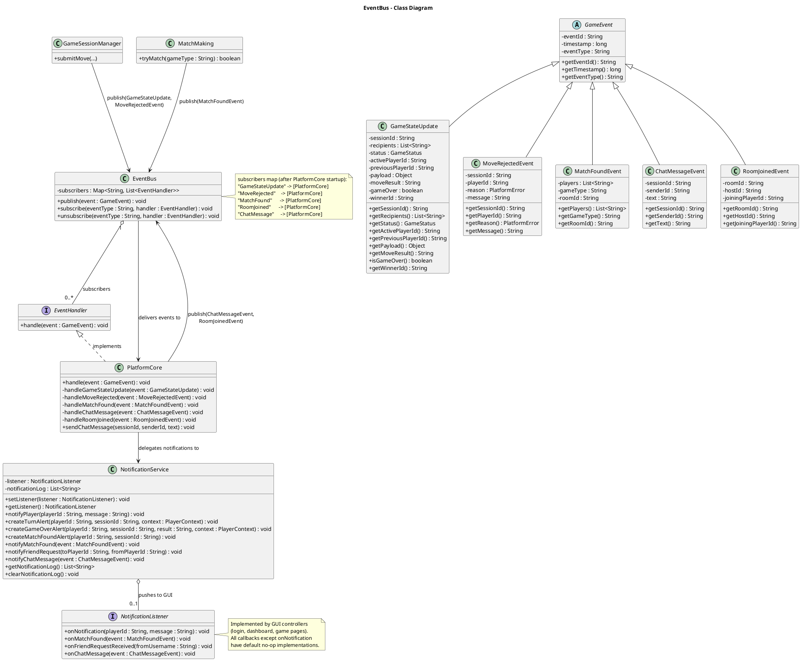

# EventBus Class Diagram (J1.1)

## About

This class diagram shows the full structure of the EventBus publish/subscribe system, including the event type hierarchy and the relationships between publishers, the bus, handlers, and consumers.

## Owner: Platform Core Sub-team

## PlantUML Editor Code

