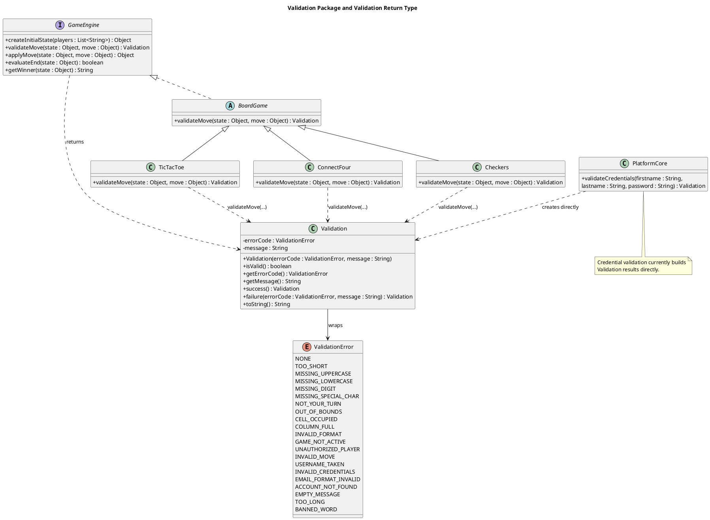

# Validation Class Diagram

## About

This class diagram shows the current validation model used by the project:

- `Validation` is the shared result object returned by validators and game engines.
- `ValidationError` standardizes the error codes used across auth, chat, and game-rule checks.
- `ChatValidator` is the explicit validator class currently modeled here.
- Game engines return `Validation` from `validateMove(...)`, and `PlatformCore` also constructs `Validation` directly for credential checks.

## Owner: Rules & Validation Sub team

## PlantUML Editor Code

