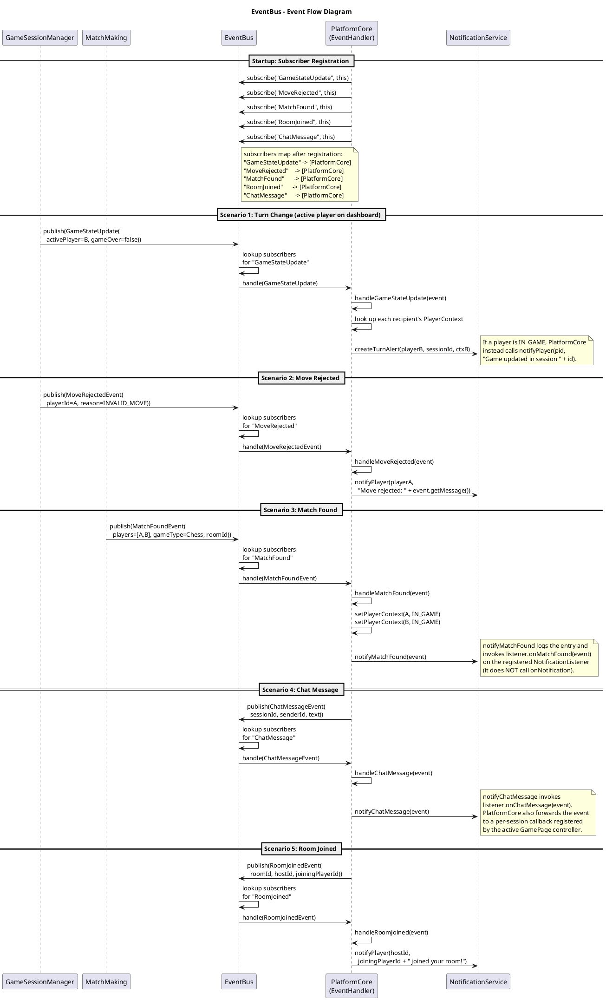

# EventBus Event Flow Diagram (J1.1)

## About

This diagram shows the runtime flow of events through the EventBus system — from the moment a publisher emits an event, through subscriber lookup and delivery, to the final handler invocation. Five concrete scenarios are shown: a turn change, a rejected move, a match being found, an in-session chat message, and a room being joined.

## Owner: Platform Core Sub-team

## PlantUML Editor Code

