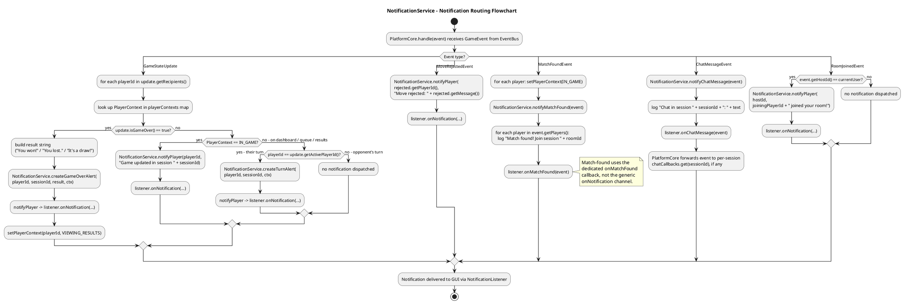

# Notification Routing Flowchart (J1.3)

## About

This flowchart shows how `PlatformCore` and `NotificationService` decide what notification to deliver, and through which `NotificationListener` callback, based on the event type and the player's current `PlayerContext`. `PlatformCore` receives a `GameEvent` from the `EventBus`, looks up each affected player's context, and delegates to `NotificationService` to push to the registered GUI listener.

**Covers:**
- Turn alerts (it's your turn) — generic `onNotification` callback
- "Game updated" alerts (mid-turn updates while a player is already in the game)
- Game over alerts (win/loss/draw) — generic `onNotification` callback
- Move rejected alerts (invalid move) — generic `onNotification` callback
- Match found alerts — dedicated `onMatchFound` callback
- Chat message alerts — dedicated `onChatMessage` callback
- Room joined alerts — generic `onNotification` callback (host only)

## Owner: Platform Core Sub-team

## PlantUML Editor Code

